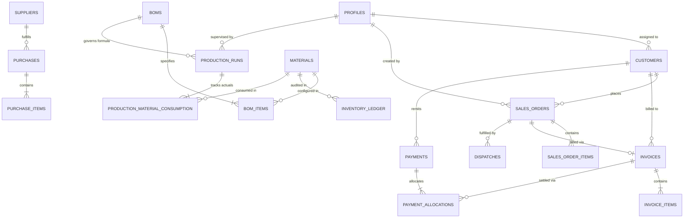

# NOIR — Factory Intelligence OS: Architectural Design Document (DESIGN.md)

**Product Tagline:** *Every material. Every movement. Every number. Accounted for.*

---

## 1. Architectural Philosophy & Principles

NOIR is engineered as a deterministic manufacturing intelligence operating system designed for small food packaging manufacturers (Murukku, Mixture, Sweets, Chips). Unlike generic ERPs or accounting software, NOIR couples physical material science directly to financial ledgers:

1. **Single Entry Point:** Transactions enter the system at their physical origin (salesman mobile terminal, factory floor scale, warehouse receiving dock).
2. **Immutable Double-Movement Stock Ledger:** Inventory is never updated via destructive overwrites (`UPDATE stock SET qty = X`). Instead, every physical reality posts an atomic debit/credit entry to `inventory_ledger`. Running balances are continuously reconciled.
3. **Recipe Tolerance Enforcement:** Production runs are continuously benchmarked against standard Bill of Materials (BOM). Deviations beyond $\pm 3.0\%$ trigger actionable industrial alerts.
4. **Weighted-Average Costing:** Real purchase delivery rates immediately reshape moving average raw material valuations:
   $$\text{New Rate} = \frac{(\text{Current Qty} \times \text{Current Avg Rate}) + (\text{New Qty} \times \text{New Purchase Rate})}{\text{Current Qty} + \text{New Qty}}$$
5. **Shared Inventory Single Source of Truth:** Sales and Production operate on identical live finished goods inventories, strictly blocking negative stock or phantom dispatches.

---

## 2. Relational Data Model & Entity Relations

---

## 3. Stock Ledger Design & Transaction Invariants

### 3.1 Immutable Movement Ledger Types
- `OPENING_BALANCE`: Certified baseline physical stock count.
- `PURCHASE_RECEIPT`: Supplier delivery received at receiving dock.
- `PRODUCTION_ISSUE`: Physical material issued to processing/frying line.
- `PRODUCTION_OUTPUT`: Finished packaged food packets added to finished goods warehouse.
- `DAMAGE`: Damaged packaging materials (pouches/boxes) ruined during mechanical sealing.
- `SALES_DISPATCH`: Finished packaged food packets loaded into dispatch truck.
- `ADJUSTMENT`: Cycle count reconciliations with required audit reason.

### 3.2 Atomicity Invariant
Stock changes are posted atomically:
- Deducting raw ingredients (Flour 40 kg, Oil 10.5 L, Spice 1.2 kg)
- Deducting packaging items (188 good pouches + 6 damaged pouches = 194 pouches, 9 cartons)
- Adding finished goods (188 packets of Murukku 200g)
Occurs in a unified transaction. If stock is insufficient, the entire operation is rejected.

---

## 4. Production Studio & Costing Logic

### 4.1 Production Costing Formula
$$\text{Material Cost} = \sum (\text{Actual Consumed Qty} \times \text{Weighted Average Rate})$$
$$\text{Packaging Cost} = \sum (\text{Actual Packaging Drawn} \times \text{Packaging Rate})$$
$$\text{Total Batch Run Cost} = \text{Material Cost} + \text{Packaging Cost} + \text{Direct Labour} + \text{Power \& Gas}$$
$$\text{Cost Per Good Packet} = \frac{\text{Total Batch Run Cost}}{\text{Actual Good Packets Produced}}$$
$$\text{Gross Margin Per Packet} = \text{Selling Price (excl. GST)} - \text{Cost Per Good Packet}$$

### 4.2 Benchmark Numerical Proof
1. **Flour Weighted Average Rate:**
   $$\frac{(100 \times 42) + (60 \times 45)}{160} = \frac{4200 + 2700}{160} = \frac{6900}{160} = \mathbf{₹43.125/\text{kg}}$$
2. **Batch Cost Components:**
   - Flour: $40 \times 43.125 = \mathbf{₹1,725.00}$
   - Oil: $10.5 \times 140 = \mathbf{₹1,470.00}$
   - Spice: $1.2 \times 200 = \mathbf{₹240.00}$
   - *Material Subtotal:* $\mathbf{₹3,435.00}$
   - Pouches: $194 \times 2.50 = \mathbf{₹485.00}$
   - Cartons: $9 \times 15.00 = \mathbf{₹135.00}$
   - *Packaging Subtotal:* $\mathbf{₹620.00}$
   - Direct Labour: $\mathbf{₹1,200.00}$
   - Power & Gas Overheads: $\mathbf{₹600.00}$
   - **Total Batch Cost:** $3435 + 620 + 1200 + 600 = \mathbf{₹5,855.00}$
3. **Unit Economics:**
   - Cost per good packet: $\frac{5855}{188} = \mathbf{₹31.1436}$ (approximately $\mathbf{₹31.14}$)
   - Selling Price: $\mathbf{₹50.00}$
   - Gross Margin per packet: $50.00 - 31.14 = \mathbf{₹18.86}$ ($37.71\%$ margin)

---

## 5. GST Engine & Decimal Safety

GST calculations adhere strictly to the Indian Goods and Services Tax statutory framework:

- **Intra-State Supply (Factory: Tamil Nadu $\rightarrow$ Customer: Tamil Nadu):**
  - CGST: $2.5\%$
  - SGST: $2.5\%$
  - For Retailer A: $150 \times ₹50 = ₹7,500$ taxable.
  - $\text{CGST} = ₹187.50$, $\text{SGST} = ₹187.50$. Total Invoice $= \mathbf{₹7,875.00}$.
- **Inter-State Supply (Factory: Tamil Nadu $\rightarrow$ Customer: Karnataka):**
  - IGST: $5.0\%$
  - For Distributor B: $120 \times ₹50 = ₹6,000$ taxable.
  - $\text{IGST} = ₹300.00$. Total Invoice $= \mathbf{₹6,300.00}$.
- **Paise Precision:** Arithmetic is computed using 2-decimal rounded half-up paise math, preventing floating-point accumulation drift.

---

## 6. Role-Based Access Control (RBAC) Architecture

| Feature Module | SALESMAN | ADMIN | PRODUCTION | AUDITOR | OWNER |
| :--- | :---: | :---: | :---: | :---: | :---: |
| **Mobile Order Creation** | Yes | Yes | No | No | Yes |
| **Order Approval & Price Override** | No | Yes | No | No | Yes |
| **BOM Formula & Recipe Master** | No | Yes | Yes | No | Yes |
| **Production Run Logging** | No | Yes | Yes | No | Yes |
| **Raw Material Inflow / Purchases** | No | Yes | Yes | No | Yes |
| **GST Invoicing & Dispatches** | No | Yes | No | No | Yes |
| **Collections / Payment Receipts** | No | Yes | No | No | Yes |
| **17 Audit Reports & Exports** | No | Yes | No | **Yes (Read Only)** | Yes |
| **Direct Mutation of Posted Ledgers**| **No** | **No** | **No** | **No** | **No** |
